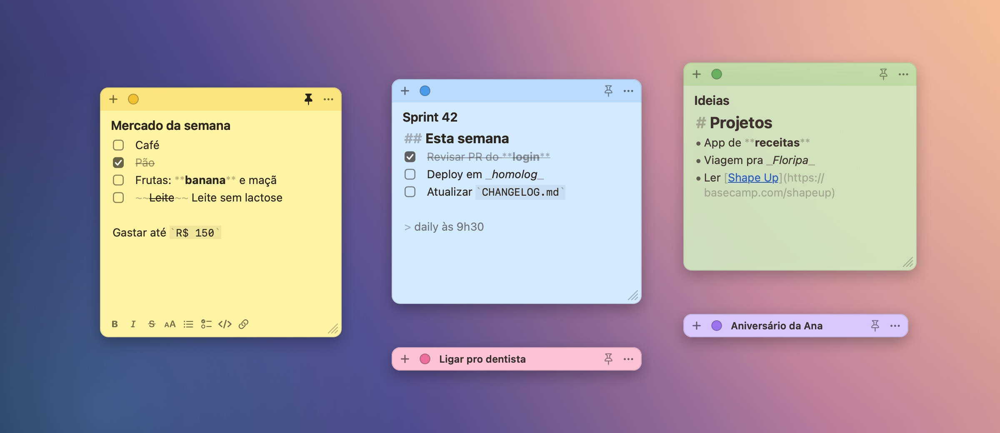
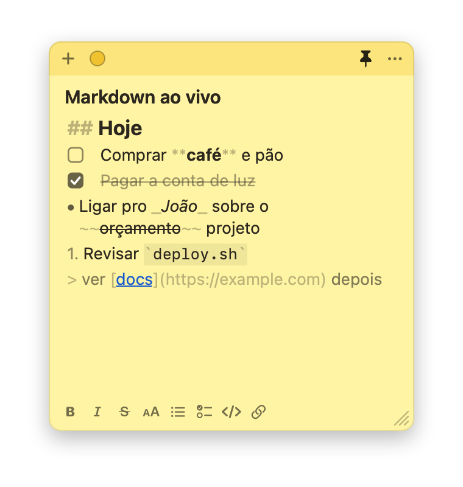
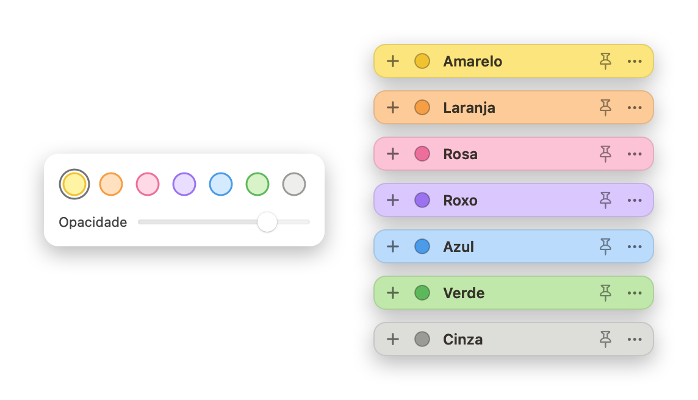

<div align="center">


# Notinhas

**Notas adesivas para o macOS que ficam no seu desktop, entendem markdown enquanto você digita e grudam por cima de tudo quando você precisa.**

[](https://github.com/victorreinor/notinhas/releases/latest)
[](#instalar)
[](#instalar)
[](Package.swift)
[](LICENSE)



</div>

## Instalar

Abra o **Terminal** (⌘ Espaço → digite `Terminal` → Enter), cole a linha abaixo e aperte Enter:

```sh
curl -fsSL https://raw.githubusercontent.com/victorreinor/notinhas/main/install.sh | bash
```

Pronto: o app vai para a pasta Aplicativos e uma nota amarela aparece na tela. Daqui pra frente, é só abrir pelo Spotlight: **⌘ Espaço → `Notinhas` → Enter**.

> Precisa de macOS 14 (Sonoma) ou mais novo, em Mac com Apple Silicon ou Intel. O mesmo comando também **atualiza** para a última versão, e suas notas continuam onde estavam. Quer saber o que ele faz antes de rodar? Leia o [`install.sh`](install.sh): são poucas linhas.

<details>
<summary><b>Prefere baixar o .zip?</b></summary>

1. Baixe o `Notinhas.zip` da [última versão](https://github.com/victorreinor/notinhas/releases/latest).
2. Dê dois cliques para descompactar e arraste o `Notinhas.app` para **Aplicativos**.
3. Na primeira vez, o macOS avisa que não pode verificar o desenvolvedor. Vá em **Ajustes do Sistema › Privacidade e Segurança**, role até o fim e clique em **Abrir Mesmo Assim** ([passo a passo da Apple](https://support.apple.com/guide/mac-help/open-a-mac-app-from-an-unknown-developer-mh40616/mac)).
   Ou, no Terminal: `xattr -dr com.apple.quarantine /Applications/Notinhas.app`

</details>

<details>
<summary><b>Quer compilar do código-fonte?</b></summary>

Basta ter as Command Line Tools da Apple (não precisa do Xcode):

```sh
xcode-select --install          # só na primeira vez
git clone https://github.com/victorreinor/notinhas.git
cd notinhas
./scripts/install-dev.sh
```

</details>

<details>
<summary><b>Por que o macOS reclama do app baixado manualmente?</b></summary>

O Notinhas é de código aberto, mas não é "notarizado" pela Apple. Isso exige uma conta paga de desenvolvedor (US$ 99/ano). O macOS bloqueia apps não notarizados que chegam pelo navegador. O instalador pelo Terminal não esbarra nisso, e o caminho manual pede só a liberação uma vez nos Ajustes.

</details>

## O que ele faz

<table>
<tr>
<td width="52%"></td>
<td>

### Markdown ao vivo
Digite `**negrito**` e ele já aparece em negrito. Os símbolos ficam clarinhos, sem sumir: o texto continua sendo markdown puro e portável.

- Checklist que você marca com um clique
- Enter continua a lista; Enter num item vazio termina
- Tab / ⇧Tab aninha itens
- Barrinha de formatação quando a nota está em foco
- Links abrem com ⌘-clique

</td>
</tr>
<tr>
<td>

### Do seu jeito
- **7 cores**, começando pelo amarelo marca-texto
- **Opacidade** ajustável pra ver o que está atrás
- **Recolher** no título com duplo clique no topo
- **📌 Fixar** por cima de tudo, em todas as mesas e sobre apps em tela cheia
- Sem o alfinete, a nota fica no desktop e as outras janelas passam por cima

</td>
<td></td>
</tr>
</table>

E mais:
- **Abre junto com o Mac** e reabre cada nota onde ela estava.
- **Discreto:** sem ícone no Dock e sem barra de menus. Abrir pelo Spotlight traz todas as notas pra frente.
- **Canto da tela:** ligue no menu **⋯** e, ao levar o mouse ao canto inferior direito, aparece uma notinha; um clique traz todas as notas. Funciona como a Nota Rápida do Mac, então desligue a dela em **Ajustes do Sistema › Mesa e Dock › Cantos Ativos**.
- **Leve:** app nativo (Swift + AppKit), sem Electron e sem navegador embutido.

## Como usar

| No topo da nota | |
| --- | --- |
| **+** | Nova nota ao lado |
| **●** | Cor e opacidade |
| **📌** | Fixar por cima de todas as janelas (de novo para soltar) |
| **⋯** | Recolher, mostrar todas, abrir ao iniciar o Mac, abrir pelo canto da tela, o que o ⌘Q faz, excluir, esconder, sair |
| Arrastar o topo | Mover a nota para qualquer lugar (inclusive outro monitor) |
| Duplo clique no topo | Recolher / expandir |
| Canto inferior direito | Redimensionar |

### Atalhos

| Atalho | Ação |
| --- | --- |
| <kbd>⌃</kbd><kbd>⌥</kbd><kbd>N</kbd> | Nova nota **de qualquer app** |
| <kbd>⌘</kbd><kbd>N</kbd> | Nova nota ao lado da atual |
| <kbd>⌘</kbd><kbd>Q</kbd> | Esconde as notas, e o app continua rodando. Para o ⌘Q fechar o app, desligue a opção no menu **⋯** |
| <kbd>⌘</kbd><kbd>B</kbd> · <kbd>⌘</kbd><kbd>I</kbd> · <kbd>⇧</kbd><kbd>⌘</kbd><kbd>X</kbd> | Negrito · itálico · tachado |
| <kbd>⌘</kbd><kbd>E</kbd> · <kbd>⌘</kbd><kbd>K</kbd> | Código · link |
| <kbd>⌘</kbd><kbd>1</kbd> <kbd>⌘</kbd><kbd>2</kbd> <kbd>⌘</kbd><kbd>3</kbd> | Título grande, médio, pequeno |
| <kbd>⇧</kbd><kbd>⌘</kbd><kbd>8</kbd> · <kbd>⇧</kbd><kbd>⌘</kbd><kbd>L</kbd> | Lista · checklist |
| <kbd>⌘</kbd><kbd>F</kbd> | Buscar na nota |
| <kbd>⌘</kbd><kbd>Z</kbd> · <kbd>⇧</kbd><kbd>⌘</kbd><kbd>Z</kbd> | Desfazer · refazer |

### Markdown que ele entende

| Você digita | Vira |
| --- | --- |
| `# Título`, `## Título`, `### Título` | Títulos |
| `**negrito**` · `_itálico_` · `~~riscado~~` | **negrito** · _itálico_ · ~~riscado~~ |
| `` `código` `` e blocos com ```` ``` ```` | `código` |
| `- item` · `1. item` | Listas |
| `- [ ] tarefa` · `- [x] feita` | Checklist clicável |
| `[texto](https://…)` ou uma URL solta | Link |
| `> citação` | Citação |

## Suas notas

Cada nota é um arquivo em `~/Library/Application Support/Notinhas/notes/`, com o texto em markdown, a cor, a posição e o tamanho. Elas entram no backup do Time Machine, sobrevivem a atualizações e nunca saem do seu Mac.

## Desinstalar

```sh
pkill -x Notinhas; rm -rf /Applications/Notinhas.app ~/Applications/Notinhas.app
```

Para apagar as notas também: `rm -rf ~/Library/Application\ Support/Notinhas`. Se o Notinhas continuar listado em **Ajustes do Sistema › Geral › Itens de Início**, é só remover de lá.

## Desenvolvimento

```sh
./scripts/test.sh           # testes da lógica de edição e da persistência
./scripts/install-dev.sh    # compila e instala sua versão local
./scripts/screenshots.sh    # regenera as imagens deste README
```

Para publicar uma versão nova no GitHub Releases, rode `./scripts/release.sh`. A versão sai sozinha da última tag: por padrão sobe o último número (0.1.0 → 0.1.1), e `[minor]` ou `[major]` no título de um commit sobe mais.

- `Sources/NotinhasCore`: modelo, armazenamento e edições de markdown (puras e testadas)
- `Sources/Notinhas`: o app AppKit (janelas, editor, atalhos, login item)

Vai mexer no código, com ou sem IA? Comece pelo [CLAUDE.md](CLAUDE.md) (mapa do código, decisões e armadilhas) e pelo [docs/ARCHITECTURE.md](docs/ARCHITECTURE.md).

## Licença

[MIT](LICENSE) © Victor Reinor
